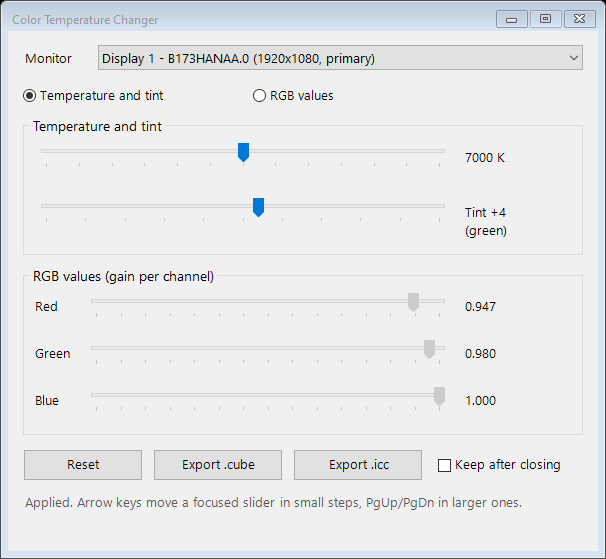

# Color Temperature Changer

A small Windows tool to change your display's white point live, **warmer or cooler** than 6500 K, with a green–magenta tint control or direct RGB values.

Most screen tools (Night Light, f.lux and similar) only go *warmer* than 6500 K, because they are made to reduce blue light. That doesn't help when a panel's white is too yellow and needs to be pushed *cooler*. This tool goes both ways, from 4000 K to 10000 K.



## Features

- **Temperature slider (4000–10000 K)**, using the CIE daylight locus, so 6500 K is exactly the sRGB white (D65) and every value is a real daylight white
- **Tint slider** that moves the white toward green or magenta, perpendicular to the daylight curve (Duv)
- **RGB values mode** to set each channel's gain directly
- **Live preview:** the screen changes as you drag
- **Per-monitor:** each display gets its own settings
- **Export** the result as:
  - a `.cube` 3D LUT for [dwm_lut](https://github.com/ledoge/dwm_lut)
  - an ICC profile (`.icc`) with calibration curves that Windows can load at every login
- **No install:** a single PowerShell script that uses only what ships with Windows

## Usage

Requires Windows 10 or 11. PowerShell 5.1 is built in.

**Option 1, download:**
1. Download the repository: Code → Download ZIP.
2. Extract it.
3. Double-click `run.bat`.

**Option 2, run from PowerShell:**

```powershell
powershell -NoProfile -ExecutionPolicy Bypass -File .\color-temperature-changer.ps1
```

**Option 3, one line, no download.** Read the script first, since this runs code from the internet:

```powershell
irm https://raw.githubusercontent.com/korcankaraokcu/color-temperature-changer/main/color-temperature-changer.ps1 | iex
```

No admin rights are needed.

**Controls:**
- Click a slider, then use the **arrow keys** for small steps and **PgUp/PgDn** for larger ones.
- **Double-click a slider's thumb**, or **right-click the slider → Reset**, to reset just that slider: 6500 K, tint 0, or RGB 1.000.
- **Reset** returns the selected display to 6500 K and tint 0, which is no change.
- When you **close the window**, every display it changed goes back to normal, unless **Keep after closing** is checked.

## Undoing "Keep after closing"

With **Keep after closing** checked, the adjustment stays active until Windows or another program resets the gamma ramp. A restart always resets it. To undo it yourself, use any of these:

- **Double-click `reset.bat`.** It returns every display to normal without opening the window.
- **Run with `-Reset`:**
  ```powershell
  powershell -NoProfile -ExecutionPolicy Bypass -File .\color-temperature-changer.ps1 -Reset
  ```
- **Open the tool**, press **Reset**, and close it.
- **Restart Windows.**

## Making a setting permanent

The live adjustment doesn't survive a reboot. To keep it, export it:

### ICC profile (built into Windows)

1. Click **Export .icc** and save the file.
2. Open **Color Management**: press Win+R, then run `colorcpl`.
3. On the **Devices** tab:
   1. Select your display.
   2. Check **Use my settings for this device**.
   3. Click **Add…** → **Browse…** and pick the `.icc` file.
   4. Select the file and click **Set as Default Profile**.
4. On the **Advanced** tab, click **Change system defaults…**. In the window that opens, go to its **Advanced** tab and check **Use Windows display calibration**.

Windows loads the profile at every login. The profile describes the display as standard sRGB, so color-managed apps treat it as a normal sRGB screen.

### 3D LUT (dwm_lut)

1. Click **Export .cube**.
2. Load the file in [dwm_lut](https://github.com/ledoge/dwm_lut)'s DwmLutGUI.

dwm_lut can also apply saturation or hue corrections, which a gamma ramp can't. It doesn't apply in exclusive fullscreen games, though, and it has to be re-applied after a reboot.

## How it works

Graphics cards have a small lookup table, the **gamma ramp**, that every pixel passes through right before it's sent to the display. It holds 256 entries per channel. Normally it's an identity table (255 → 255), so nothing changes. This tool fills it through the Windows `SetDeviceGammaRamp` API, scaling each channel: `output = input × gain`.

For a temperature and tint, the gains are calculated like this:

1. **Temperature → chromaticity:** the CIE daylight locus formula gives the white point's xy coordinates for the chosen temperature.
2. **Tint:** the white point is moved in CIE 1960 uv space, perpendicular to the daylight curve, by 0.0004 Duv per tint step.
3. **Chromaticity → RGB:** the xy point is converted to linear sRGB and divided by the D65 values, so 6500 K and tint 0 give exactly 1, 1, 1.
4. **Normalize and encode:** the gains are scaled so the largest channel is 1.0, which means nothing clips and only a little brightness is lost. They're then converted to gamma-encoded values (gamma 2.2).

This is the same table that ICC profiles' calibration curves (`vcgt`), Night Light and f.lux use.

## Limitations

- **Per-channel changes only.** A gamma ramp can change white point, gamma and contrast, but not saturation or individual hues. Those need a 3D LUT.
- **Windows limits extreme values.** Windows rejects gamma ramps that are too far from normal, and the status line says so when this happens. Setting the registry value `HKLM\SOFTWARE\Microsoft\Windows NT\CurrentVersion\ICM\GdiIcmGammaRange` (DWORD) to `256` removes that limit. This is advanced, and you use it at your own risk.
- **Other programs can overwrite it.** Night Light, f.lux, some games, GPU control panels and Windows' Calibration Loader also write to the gamma ramp, and the last one to write wins.
- **It stacks with other corrections.** It applies on top of any ICC calibration or dwm_lut LUT that's already active, so turn those off while you test.
- **Displays without gamma ramp support:** some displays, remote desktop sessions and HDR mode may ignore it or reject it.
- **Tested hardware is limited:** tested on Windows 10 with Intel integrated graphics. Reports from other setups are welcome.

## License

[MIT](LICENSE)
